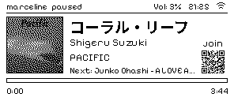
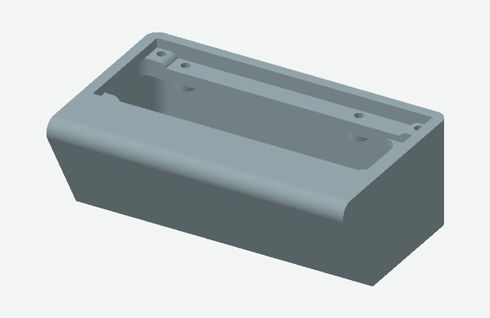
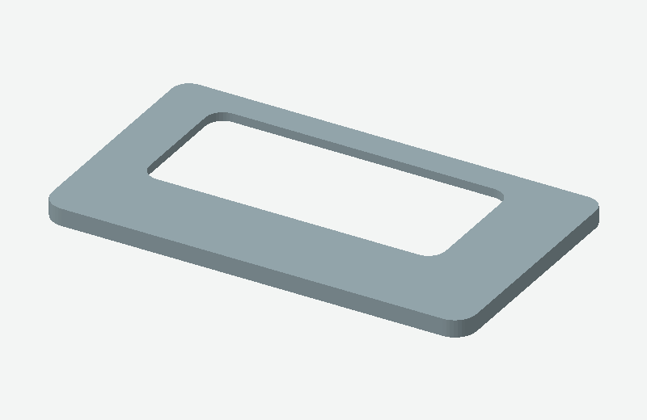
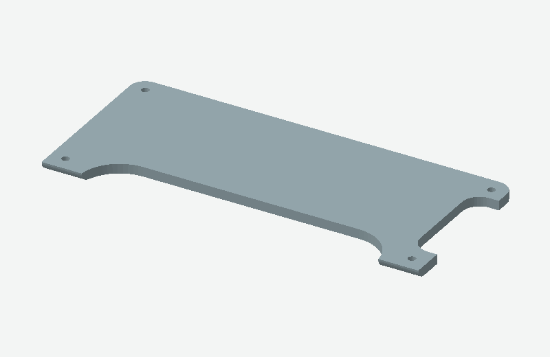

# Pi E-Ink Music Player

A Raspberry Pi powered display for Music Assistant. Designed for the Pi Zero W, PCM5102a, and an SSD1680 based 296*128 2.9inch eink. An easy project, and definitely overkill for what you'd actually require to do this.

<p align="center">
	
</p>

## Requirements

- Raspberry Pi
- PCM5102a or equivalent
- SSD1680 296*128 Eink
- An existing Music Assistant Server to setup this device as a player for (either sendspin or snapcast).

Check that you've hooked everything up as expected before proceeding. See the [hardware guide](docs/PCM5102A-Hardware-Guide.md) for more info.

## Installation

This was designed around a fresh DietPi setup (10.8.2 Raspbian Trixie), however can be run on any distribution. The installer however, was only designed to run on this version of DietPi. If you want to install this elsewhere its easy enough to read install.py and figure out what needs to be done. 

For a fresh DietPi setup, run the interactive installer from the project directory:

```sh
sudo python3 install.py
```

The installer configures the Pi, creates the application service, and offers Snapclient, Sendspin, or no audio client. It creates the .env and modifies system configuration. Reboot after installation.

If you chose Sendspin, run its upstream installer after reboot, once the DAC is available:

```sh
curl -fsSL https://raw.githubusercontent.com/Sendspin/sendspin-cpp-cli/main/scripts/get_started_linux.sh | bash
```

Follow the upstream installer to configure Sendspin, then begin pairing on your server and check `sudo journalctl -u sendspin-cli -f` for the pairing code.

For a manual installation on Debian-based systems (not including snapclient or spi setup):

```sh
sudo apt install fonts-noto-cjk
python3 -m venv .venv
.venv/bin/python -m pip install -r requirements.txt
```

Create a `.env` file in the project directory:

```dotenv
MA_URL=http://YOUR_MUSIC_ASSISTANT_IP:8095
MA_TOKEN=YOUR_LONG_LIVED_TOKEN
MA_PLAYER=YOUR_PLAYER_NAME
```

`MA_PLAYER` is optional and defaults to the Pi's hostname. Keep the token private.

## Run

To run on the display:

```sh
.venv/bin/python main.py
```

To preview the screen without a display, run:

```sh
.venv/bin/python main.py --test
```

The preview is saved as `ui.png`. Stop either mode with Ctrl+C. Run `.venv/bin/python main.py --help` for available options.

Other options:

- `--party-qr`: Show the Party guest join QR code. Guest access must be enabled in the Music Assistant Party plugin.
- `--time-format 12`: Show the clock in 12-hour format instead of 24hr


## Case

There is a 3d model for the low effort case i designed for this. This was a stepping stone project before making a more reasonable version of this capability, so the design is very basic. I held all the breakout boards on the inside with double-sided foam backed tape, and glued the front panel on after inserting the screen. 

It could also be way lower profile but decided to make it large enough to fit ribbon cables and pin headers because i didnt want to permanently solder this setup. 





## Extra Documentation

- [Hardware and wiring guide](docs/hardware.md)
- [Software explanation](docs/software.md) 