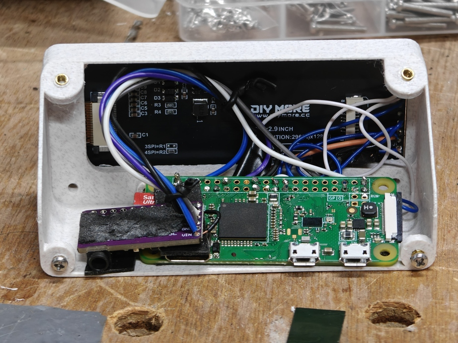
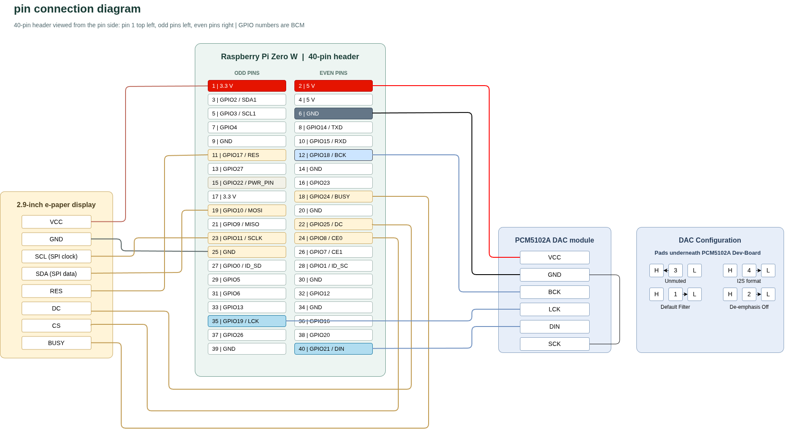

# Hardware

What hardware needs to be bought, and how it needs to be setup for this project. 

Here's what this inside of mine looks like (absolutely terrible):

## Bill of Materials

- [Raspberry Pi Zero W](https://core-electronics.com.au/raspberry-pi-zero-w-wireless.html): $28.50
- [PCM5102a DAC Breakout](https://www.aliexpress.com/item/1005005713484762.html): $4
- [2in9 EInk Display](https://www.aliexpress.com/item/1005013092704861.html): $12

Total Cost: $44.5

## Connection Layout

## Extra Notes

### PCM5102A Pinout 

**VCC**- despite the pcm5102a itself being a 3v3 chip, we power it from 5v. On my breakout board this wasn't labelled, but next to the VCC pin you can spot a 3v3 Low-Dropout-Voltage Regulator (insert IC name).

**GND**- can go to any ground

**DIN**- audio data in, connects to the PCM_DOUT (Data Out)

**LRCK**- left/right clock (is the data being sent left/right channel), connects to PCM_FS (Frame Sync)

**BCK**- bit clock (main clock signal), connects to PCM-CLK (Clock)

**SCK**- system clock (external clock input), isn't used, DAC can generate its own internal clock. Make sure this is connected to GND, otherwise it can pick up RF/Noise and treat it as an external clock causing playback issues.

### PCM5102A Solder Pad Configuration

The solder pads on the back of PCM5102a breakouts are for setting 4 different DAC settings. They are soldered from the center pin to either HIGH or LOW to set the parameter. The parameters are as follows noting some breakouts are incorrectly silkscreened.

#### DEMP:

Add de-emphasis to audio- only useful is the audio already has pre-emphasis. L is off, H is on, so we bridge it L.

#### FLT:

Choose between a low-latency or normal-latency digital filter. H is low-latency, for general audio playbay normal is acceptable, so we bridge it L. 

#### XSMT:

Controls whether the DAC audio is muted. H enables audio, and L mutes it, so with bridge it H. 

#### FMT:

Sleects how the audio is timed relative to the left/right clock. Either I2S is L, Left-Justified is H- the Pi is expecting I2S, so bridge it L.

### E-ink Display

The waveshare library by deafult uses GPIO18 as a PWR_PIN even though we arent using it, this interferes with the DAC. The PWR_PIN has therefore een changed to GPIO22.

SDA/SCL although named after i2c pins, these are actually the SPI clock and Data lines for the display