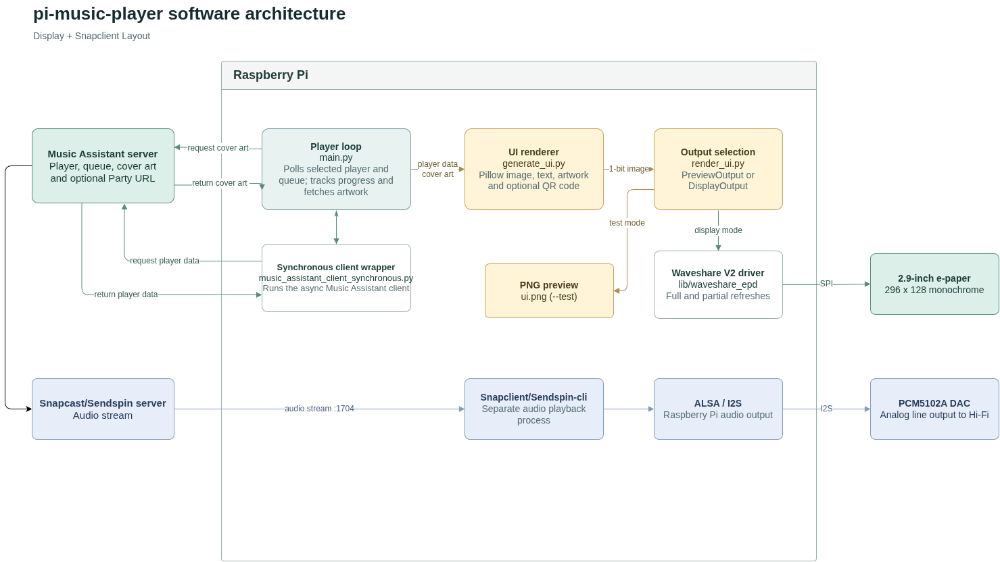

# Software

The display application and audio player are separate processes. The application connects to Music Assistant to find the selected player, fetch its queue and artwork, and draw a now-playing screen. Snapclient or Sendspin handles the audio stream and sends it through ALSA and I2S to the DAC; the display application does not play audio or control playback.

The diagram labels the audio stream with port `1704`, the default Snapcast stream port. Sendspin uses its own connection and ports; it does not use Snapcast's stream port.

## Why Music Assistant supplies the metadata

All song and player metadata shown by the display is fetched from the Music Assistant server itself, not from Snapclient or Sendspin. This design dates from when the project only supported Snapclient, which does not provide the song metadata needed for the screen. Keeping that connection also makes the display independent of the chosen audio client.

Direct access to Music Assistant is also needed for the optional Party QR code. The application requests the Party guest join URL from Music Assistant and turns it into a QR code so guests can join. Guest access must be enabled in the Party plugin; the QR code is disabled by default and enabled with `--party-qr`. 

## Data flow

1. `main.py` loads the Music Assistant URL and access token, then selects the player named by `MA_PLAYER`, or the local hostname if it is unset. Player names must match; if multiple players have the same name, the first match is used.
2. The loop requests the player list and active queue, using the current queue item for title, artist, album, duration and artwork, and the next item for the next-track label. Playback state and volume come from the player. When there is no current queue item, the last track details are retained if available.
3. Cover art is downloaded using the server URL and access token. The application avoids downloading it again while the URL remains unchanged, checks that the response is an image, and limits it to 5 MiB. Failed downloads are retried on later iterations.
4. `generate_ui.py` uses Pillow to turn the data into a monochrome image. It also draws local information such as the clock and Wi-Fi signal, plus the optional Party QR code. The Wi-Fi signal is read on the Pi, not from the Music Assistant server.
5. `render_ui.py` either saves the image as `ui.png` in preview mode or sends it to the e-paper driver. Preview mode does not require the display hardware.

The loop targets one update per 3 seconds. The client wrapper in `music_assistant_client_synchronous.py` runs the asynchronous Music Assistant client behind synchronous calls, keeping the main loop straightforward (because i hate async unless absolutely required). Client requests time out after 15 seconds.

### Progress and connection handling

The displayed progress normally uses Music Assistant's corrected elapsed time. There is also a local monotonic-clock estimate for cases where the server keeps updating its timestamp without advancing the elapsed value. This is a workaround for a bug i noted with the music assistant API where after pausing/selecting an ew song it would sometimes stop updating elapsed time. 

For supported connection and authentication errors, the application shows a connection-error screen and retries after 10 seconds. Music Assistant remains necessary for the display even if audio playback continues independently.

## Display rendering

The renderer produces a 296 x 128, one-bit landscape image. The display output uses the local Waveshare `epd2in9_V2` driver: it performs a full refresh for the first image and when the song changes, and uses partial refreshes for other changed images. Identical images are not sent again. On exit, the display is put to sleep, retaining its last image.

The UI uses Pixelify Sans where the characters are available and falls back to Noto Sans CJK for text requiring other glyphs. The clock uses the Pi's local time; `--time-format 12` selects a 12-hour clock, with 24-hour time as the default. `WIFI_INTERFACE` selects the local interface, defaulting to `wlan0`; unavailable signal data is shown as an unavailable Wi-Fi indicator.

## Configuration and installation

The application reads `.env` next to `main.py`, without overriding existing environment variables:

- `MA_URL`: Music Assistant server URL.
- `MA_TOKEN`: Music Assistant long-lived access token. Keep it private.
- `MA_PLAYER`: player name, optional; defaults to the Pi's hostname.
- `WIFI_INTERFACE`: local Wi-Fi interface, optional; defaults to `wlan0`.
- `MA_COVER_PATH`: local artwork path, optional; defaults to `cover-art.jpg`.

Run `main.py --test` to preview without the display, or run it without `--test` for the physical panel. See the [README](../README.md) for setup and usage commands and the [hardware guide](PCM5102A-Hardware-Guide.md) for wiring and display compatibility.

The install.py offers Snapclient, Sendspin, or no audio client. For Snapclient it configures the Snapserver address, stream port and DAC output. For Sendspin it runs the upstream installer and provides pairing instructions; custom server configuration is not implemented yet- follow their interactive install script and set it up yourself. It also configures the application environment, display and DAC boot settings, and systemd service. Reboot to apply the hardware settings.
